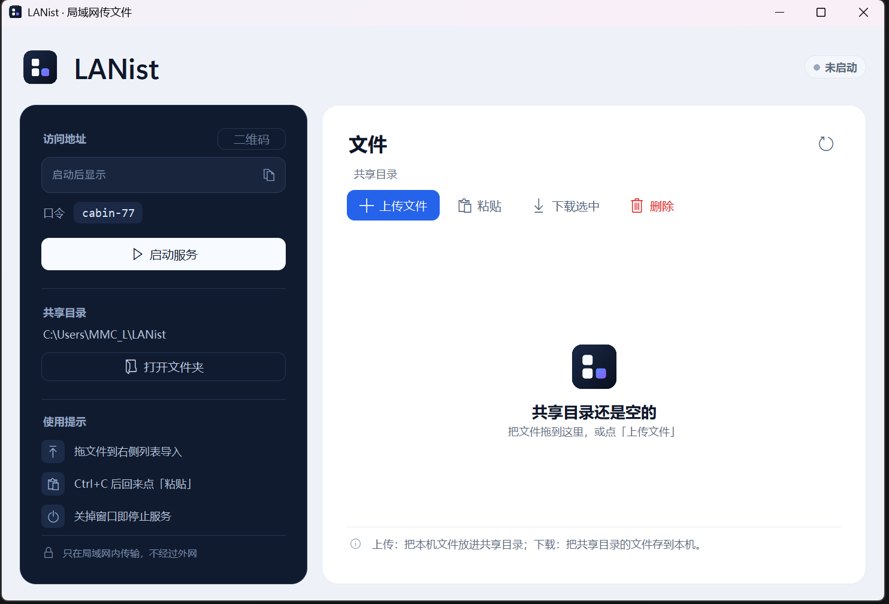

# LANist



LANist 是一个只在局域网里工作的小型文件互传工具：一台电脑开着服务，同一网络里的手机、平板、另一台电脑用浏览器打开链接，就能上传或下载共享目录里的文件，访问端不用安装 App。支持多选、拖放、子文件夹、二维码和跟随系统的深浅色网页。没有账号、云端和外网依赖，关掉主机窗口链接立即失效。

## 环境

- Python 3.9 或更新版本（在 Python 3.15 上验证）
- Windows 10/11 用于窗口界面；无窗口模式在 Windows 上验证过，其他系统未验证
- 窗口内拖入文件需要 `tkinterdnd2`，仓库里带了 Windows x64 的副本；其他平台可以自行安装

## 快速开始

在项目目录里：

```bash
python -m lanist
```

Windows 也可以双击 `LANist.cmd`。窗口打开后点“启动服务”，把左侧地址发给同一局域网里的设备，用浏览器打开即可。

第一次运行会生成类似 `fox-42` 的口令，并保存在 `%APPDATA%\LANist\config.json`。链接里已经带口令；窗口里点“二维码”，手机扫码就能打开。

### 用 exe 启动

从 GitHub Releases 下载发布包，解压后双击其中的 `LANist.exe`。从源码运行时，先执行 `tools\build-release.cmd`，产物在 `release\`。

`LANist.exe` 是一个轻量启动器，本身不带 Python 运行时，要求本机已装 Python 3.9 或更新版本（安装时保留 py launcher 与 tcl/tk）。双击它会依次尝试 `pyw`、`pythonw`、`py`、`python` 启动 `lanist`。

`LANist.exe` 必须和同目录下的 `lanist` 文件夹放在一起，整个文件夹可以一起移动或复制。没有找到 Python 时会弹出提示，不会静默失败。

### 手机访问

1. 主机开好服务，确认手机和主机连在同一个 Wi‑Fi（或同一局域网）。
2. 点窗口“访问地址”右边的“二维码”，用手机相机扫码；扫不出来就把窗口里的链接手输到浏览器。
3. 点上传区选择文件；上传固定落在共享目录根目录。点文件夹进入下一层，点文件下载。
4. 手机页面按触屏做过适配：按钮加大到 42px、整行可点、面包屑横向滑动、隐藏时间列、适配刘海与底部安全区。

如果手机打不开：先确认是同一个网络；再看路由器是否开了“访客网络”或“AP 隔离/客户端隔离”（开了会挡住设备互访）；最后检查主机的防火墙是否允许 Python 在专用网络接收入站连接。不要用关闭防火墙来“解决”问题。

### 只在终端里跑

```bash
python -m lanist --no-gui
python -m lanist --no-gui --share "D:\某个目录" --port 8000
python -m lanist --new-token
```

常用参数：

| 参数 | 说明 |
| --- | --- |
| `--share 目录` | 共享目录，默认 `~/LANist` |
| `--port 端口` | 监听端口，默认从 8000 起自动挑空闲端口 |
| `--host 地址` | 监听地址，默认 `0.0.0.0` |
| `--token 口令` | 指定口令并保存，方便固定链接 |
| `--new-token` | 重新生成随机口令 |
| `--no-gui` | 不打开窗口 |

## 安全说明

- 只应在你信任的局域网里使用，不要把端口转发到公网，也不要关闭系统防火墙来“解决”访问问题。
- 口令是访问控制，不是加密。HTTP 传输不提供机密性；同一网络里的抓包者仍可能看到内容。
- 拿到链接的人可以列出、下载和上传共享目录里的文件。发链接前确认收件人。
- 共享目录里的文件会原样提供给访问端；不要放敏感文件。
- 口令较短，随机空间约 6000 种；配合按 IP 的失败限速，只适合可信的家庭或办公室局域网。不要把服务暴露到不可信网络。
- 服务停止或窗口关闭后，链接立即失效。

从早期测试版升级时，旧的两词口令（如 `amber-otter-42`）会在首次启动时自动换成短口令，旧链接随之失效。

## 开发与测试

```bash
python -m unittest discover -s tests
```

项目结构：

```
lanist/          服务端、窗口、CLI、网页模板
  server.py      无窗口的 HTTP 服务与认证
  store.py       共享目录读写、子文件夹与文件名处理
  gui.py         Tk 窗口与二维码弹窗
  web/           浏览器页面；fonts/ 内置标题字体
  vendor/        tkinterdnd2 与 qrcodegen
tests/           单元、HTTP、CLI 与窗口冒烟测试
tools/           exe 启动器源码与打包脚本
release/         打包产物（LANist.exe + lanist/ + 文档），不纳入 git
```

打包：

```bash
tools\build-release.cmd
```

脚本用 Windows 自带的 .NET Framework `csc.exe` 编译启动器，不下载任何东西；`release/` 每次重建。

## 许可

MIT，见 `LICENSE`。

## 致谢

界面参考了 LocalSend 的桌面布局、Windows 11 Fluent 的层级与圆角做法，以及 Refactoring UI 的间距与对比度思路。网页标题使用 Space Grotesk，字体文件随程序离线内嵌。窗口拖放使用 tkinterdnd2 与 tkdnd，二维码使用 Project Nayuki 的 qrcodegen。详见 `THIRD_PARTY.md`。
